# Diego Alonso

**Registered nurse building digital health.**

I spent 15 years in clinical practice before moving into digital health. In 2019, the Nursing Directorate of Hospital Universitario de La Princesa (Madrid) appointed me referent-consultant for the rollout of the hospital information system. I reported real-world usability issues from the care workflow, proposed UX improvements and took part in QA before the large-scale deployment.

## What I work on

- **EHR implementation and clinical UX:** making health software work for the people who use it during a night shift.
- **Interoperability:** HL7 FHIR, openEHR and SNOMED CT.
- **AI applied to healthcare:** digital triage and patient-facing tools.
- **Digital health projects for the common good:** open-source tools that any person or organization can use.

## Background

- Master's in Digital Health / eHealth, Universidad Europea (2025-26)
- SNOMED CT fundamentals, SNOMED International
- ICD-10 clinical coding
- Good Clinical Practice (GCP), NIDA Clinical Trials Network

## Tech

**Languages:** Python · **Tools:** Git, GitHub, cloud · **AI:** Claude Code, AI agents · **Health standards:** HL7 FHIR, openEHR, OMOP, SNOMED CT, ICD-10

## Open to

Remote work and collaborations with digital health startups that need someone who knows how their product behaves in a real hospital.

## Contact

- LinkedIn: **[[YOUR LINKEDIN URL]]**
- Based in Las Palmas de Gran Canaria, Spain
